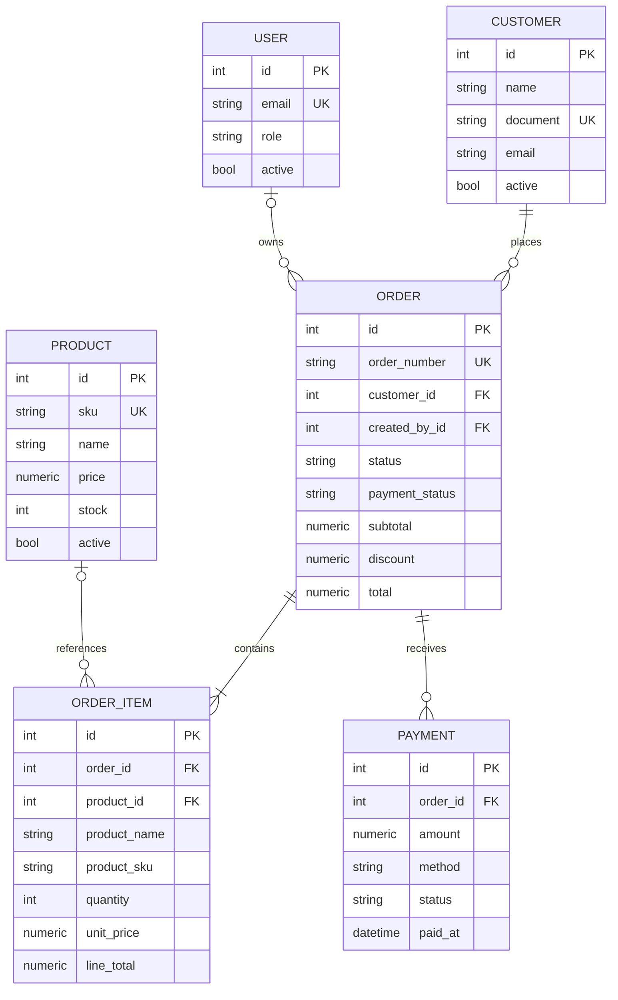

# Architecture

NODO is a server-rendered FastAPI application with a JSON API used by its own vanilla-JavaScript frontend. The same API can also serve external clients.

## Request flow

```text
Browser or API client
        |
        v
FastAPI route + Pydantic validation
        |
        v
Business service
        |
        v
SQLAlchemy session / transaction
        |
        v
PostgreSQL
```

Jinja2 renders the initial HTML shell. Page-specific JavaScript then requests data from `/api`, updates tables and metrics, and submits mutations using JSON. There is no separate frontend server or asset compilation step.

## Modules

| Module | Responsibility |
|---|---|
| `app/api` | HTTP routing, query parameters, status codes, transaction commits, and rollbacks |
| `app/schemas` | Validation and serialization of public contracts |
| `app/services` | Order totals, status transitions, payments, and dashboard aggregation |
| `app/models` | SQLAlchemy entities, relationships, enums, constraints, and indexes |
| `app/db` | Engine, session factory, and declarative base |
| `app/templates` | Server-rendered Spanish UI structure |
| `app/static` | Visual system and API-driven browser interactions |
| `alembic` | Versioned database schema |

## Domain model



`OrderItem.product_id` and `Order.created_by_id` are nullable so historical records survive a future physical deletion. The normal application flow uses soft deletion for customers and products.

## Order transaction

Order creation follows one atomic sequence:

1. Validate the customer and optional owner.
2. Read all requested active products with `SELECT ... FOR UPDATE` on PostgreSQL.
3. Reject missing, inactive, or duplicated products.
4. Copy product names, SKUs, and current prices into line-item snapshots.
5. Calculate line totals and the subtotal with `Decimal` arithmetic.
6. Validate the discount and calculate the final total.
7. Flush the order and its line items.
8. Commit in the route handler, or roll back the complete operation on failure.

No partial order can remain after a handled error.

## Historical pricing

The product table is the current catalog, not an accounting ledger. Historical orders therefore never resolve their displayed prices from `Product.price`. They use `OrderItem.unit_price`, captured when the order was created. Product name and SKU are copied for the same reason.

## Status transitions

```text
draft -----> confirmed -----> completed
  |              |
  +--------------+----------> cancelled
```

Completed and cancelled states are terminal. Payment state progresses independently from `pending` to `partial` and then `paid`, based on completed payment records.

## Reporting

The dashboard service combines database aggregation with a small amount of application-level time-series shaping:

- Counts and sums are performed in SQL.
- Cancelled orders are excluded from commercial totals and rankings.
- Payments are aggregated in a subquery to calculate outstanding balances.
- Twelve calendar-month buckets are completed in Python so months without sales still appear in the chart.
- Rankings are limited at the database level.

## Persistence and migrations

Production uses PostgreSQL through the Psycopg 3 driver. Alembic is the only schema-management mechanism during application startup. The application does not call `create_all()` in production.

SQLite is used by the automated tests and is available for lightweight local previews. Database constraints mirror Pydantic validation for critical invariants such as positive quantities and non-negative monetary values.

## Security scope

The current portfolio release models users and order ownership but does not implement authentication or authorization. It must not be exposed as a multi-user production system without adding identity, access control, CSRF considerations, secret management, and deployment-level transport security.

